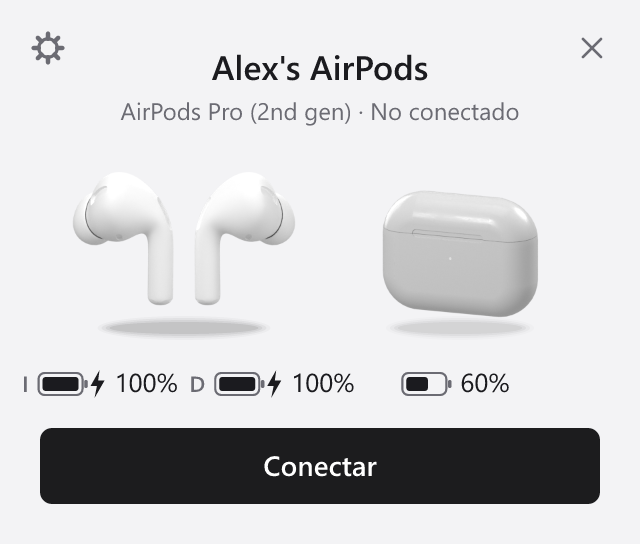
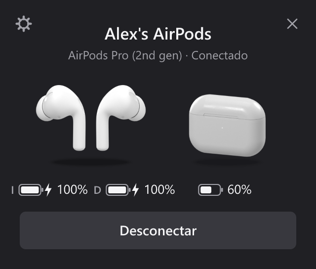
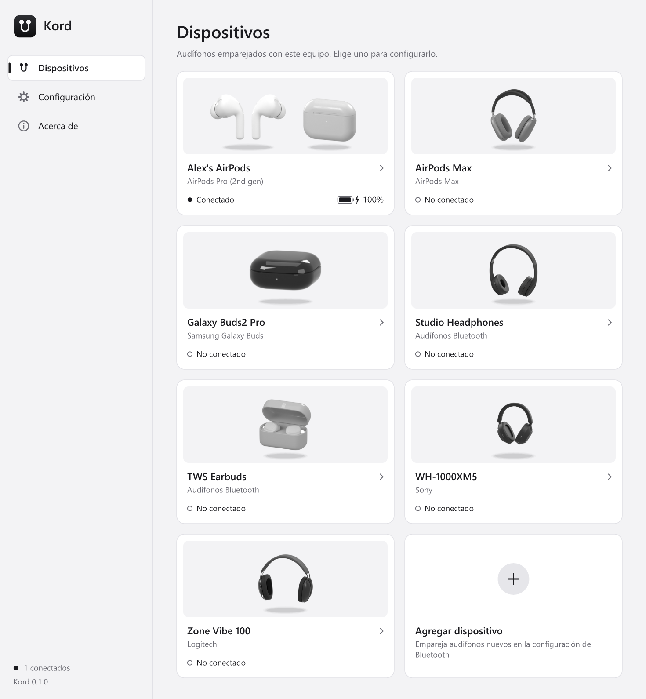
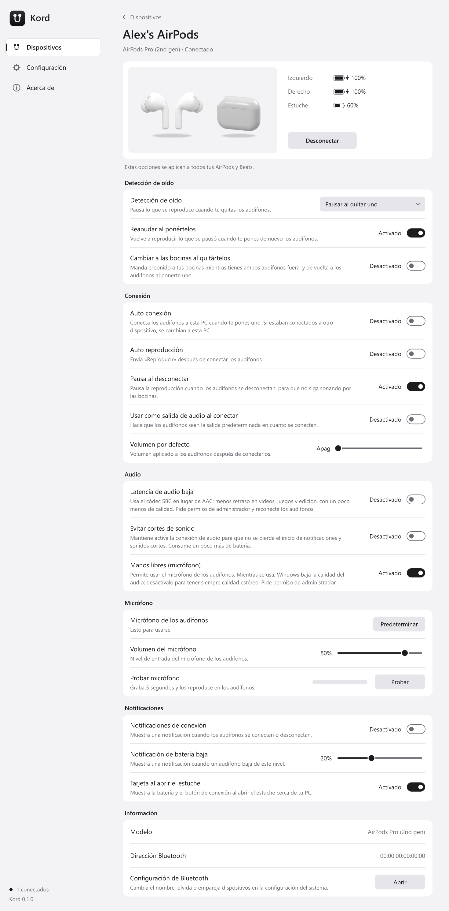

<p align="center"></p>

# Kord

A lightweight, open-source companion for **AirPods and other wireless headphones** on
**Windows and Linux**, written in Rust.

<p align="center">
  
  
</p>

- **Status card when you open the case**, like on a phone: floating 3D-rendered
  earbuds and case, battery of each, charging state, and a one-click
  **Connect / Disconnect** button
- Battery in the system tray (click the icon for the card, right-click for the menu)
- **Ear detection**: pauses whatever is playing when you take an earbud out and resumes
  it when you put it back — only when the headphones are connected to *this* computer
- **Main window**: a card for every pair of headphones paired with the computer (with
  3D art for AirPods, Beats, Galaxy Buds, Sony, JBL, Jabra, Logitech and generic ones),
  and a page per device with its batteries, Connect/Disconnect and every option below
- **Connection**: auto connect when you put an earbud in, auto play, pause on
  disconnect, default volume, make them the default output, connection notifications
- **Audio** *(Windows)*: low-latency mode (SBC instead of AAC), "prevent sound
  cut-offs" (keeps the Bluetooth link awake), hands-free on/off, switch to the speakers
  while both earbuds are out
- **Microphone** *(Windows)*: make the headphones the default mic, input volume, and a
  record-and-play-back test with a live level meter
- Low-battery notifications, search range, ignore other people's AirPods, start with
  the system
- Light and dark themes, English and Spanish
- ~3 MB binary, ~5 MB of RAM idle, no background services or drivers
- MIT licensed

<p align="center">
  
</p>
<p align="center">
  
</p>

> Status: early (v0.1). AirPods and Beats are the first supported family; the core is
> built so other brands can be added (see [Adding a device](#adding-a-device)).

## Download

Get the latest build from [Releases](https://github.com/AbrahmCh1/Kord/releases/latest):

- **Windows 10/11**: `Kord-<version>-windows-x64.zip`. Unzip anywhere and run
  `kord.exe`; it opens its window and stays in the tray. Turn on *Start with the system*
  in Settings to have it at login.
- **Linux (x86-64)**: `Kord-<version>-linux-x86_64.tar.gz`. Needs GTK 3, libayatana-appindicator
  and BlueZ, which desktop distros already have. Run `./kord`.

Kord is not signed yet, so Windows SmartScreen may warn the first time: *More info →
Run anyway*.

## How it works

AirPods constantly broadcast a small Bluetooth LE advertisement (Apple's "Proximity
Pairing" message) with battery levels, charging, in-ear and lid state. Kord listens to
those advertisements, so it works **without pairing anything extra** and the same way on
Windows and Linux. Pairing and audio stay with your OS's normal Bluetooth settings.

Because everyone's AirPods broadcast the same thing, Kord only follows models paired
with your computer and locks on to the strongest one nearby (by model and colour). If it
picks up someone else's pair, set the search range to "Near" (see [Settings](#settings)).

The advertisement's model id is then matched to the headphones paired with your
computer (their Bluetooth Device ID), which gives Kord their name, whether they are
connected *here*, and a way to connect them:

- **Windows**: through the Bluetooth audio driver, the same request the Settings app's
  "Connect" button sends
- **Linux**: through BlueZ (`org.bluez.Device1.Connect`)

For ear detection Kord asks the OS which players are *actually playing*, pauses exactly
those and later resumes exactly those, so it never starts music by accident. It does
nothing while the headphones are connected to another device (your phone, say):

- **Windows**: System Media Transport Controls (Spotify, browsers, Media Player…)
- **Linux**: MPRIS over D-Bus (Spotify, Firefox, Chromium, VLC, mpv…)

## Usage

```
kord                       # run in the system tray and open the main window
kord tray                  # tray only (what autostart uses)
kord tray --show           # tray, opening the status card right away
kord tray --open           # tray, opening the main window
kord headless              # ear detection without tray icon, logs to the terminal
kord scan [--all]          # print headphone advertisements nearby (--all: every one, timed)
kord device 0x1420         # pairing, connection and audio state (--connect / --disconnect)
kord config-path           # where the settings file lives
```

Set `RUST_LOG=kord=debug` for more logging.

### Settings

Open the main window (start Kord again, double-click the tray icon, tray menu → Open Kord,
or the gear on the status card). **Devices** lists every pair of headphones paired with
the computer as a card; click one for its page: batteries, Connect/Disconnect, ear
detection, connection, audio, microphone and notification options. **Settings** holds
the app's own options (theme, language, autostart, search range). Only one Kord runs at
a time: starting it again just brings the window up. Everything
is stored in a TOML file you can also edit by hand (tray menu → "Open settings file";
hand edits apply on restart):

```toml
[general]
theme = "system"           # "system", "light" or "dark"
language = "auto"          # "auto", "en" or "es"

[ear_detection]
enabled = true
pause_when = "any"         # "any": one earbud out pauses; "all": only when both are out
resume = true              # resume when they go back in
switch_output_when_removed = false  # speakers while both earbuds are out
debounce_ms = 300          # ignore readings shorter than this
resume_window_secs = 600   # don't resume after this long (0 = always resume)

[connection]
auto_connect = false       # connect here when you put an earbud in
auto_play = false          # press play after connecting
pause_on_disconnect = true # don't let music continue on the speakers
default_volume = 0         # volume (%) applied after connecting; 0 = leave alone
switch_output_on_connect = false    # make them the default output
notify_connection = false

[audio]
keep_alive = false         # keep the Bluetooth link awake (no cut-off sounds)

[notifications]
low_battery = 20           # notify at this % (0 = off)

[tracking]
min_rssi = -70             # ignore weaker devices (dBm); try -60 in crowded places
lost_after_secs = 15
only_paired = true         # only follow models paired with this computer
# only_model = "0x1420"    # lock to your model id (shown by `kord scan`)

[popup]
show_on_lid_open = true    # show the status card when you open the case
```

Low latency and hands-free are Windows settings rather than Kord's, so they're not in
the file. Changing them needs administrator rights: Kord runs a second copy of itself
through the normal UAC prompt to make just that change, then reconnects the headphones.

## Building

Requires Rust 1.88+.

**Windows** — nothing else needed:

```
cargo build --release
```

**Linux** — install the GTK/AppIndicator (tray) and D-Bus (Bluetooth) headers first:

```
# Debian/Ubuntu
sudo apt install pkg-config libdbus-1-dev libgtk-3-dev libayatana-appindicator3-dev libxdo-dev
# Fedora
sudo dnf install pkgconf dbus-devel gtk3-devel libayatana-appindicator-gtk3-devel libxdo-devel

cargo build --release
```

Bluetooth must be on, and on Linux BlueZ must be running (it is on every desktop distro).

## Project layout

| Crate | What it does |
|---|---|
| `crates/kord-core` | Pure logic, no I/O, fully unit tested: advertisement decoders, device tracker, ear-detection state machine |
| `crates/kord` | The app: BLE scanner (`btleplug`), pairing lookup and connect (`link`), media control (`media`), tray (`tray-icon` + `tao`), status card (`popup`, drawn with `tiny-skia`), CLI, settings |

The status card and main window are software-rendered with the system UI font
(Segoe UI on Windows, your fontconfig sans-serif on Linux) and only exist while on
screen. Run `kord render-popup <dir>` to render every variant to PNG while working on them.

Device art comes from 3D models (`assets/model/`) rendered once to PNG sprites with
Blender (`tools/render_model.py`, commands in `crates/kord/assets/sprites/CREDITS.md`),
so the app never loads 3D at runtime. Headphones without art of their own get a generic
over-ear or in-ear render.

To add art for more headphones:

1. `python tools/find_models.py --report assets/model/candidates.md` searches Sketchfab
   brand by brand (`--brand sony samsung`, or free text: `"galaxy buds2"`) and lists
   only downloadable models under CC BY or CC0 (`--share-alike` adds CC BY-SA), with
   author, polygon count and size. No account needed.
2. Pick one and download it with `python tools/find_models.py --download <uid> --to
   assets/model/<Name>`. This needs a Sketchfab API token in `SKETCHFAB_TOKEN`. It
   saves the `.glb` and a credit line next to it. The `.glb` files are not in git;
   `tools/download_selected.ps1` downloads every model the current sprites use.
3. Render it with `tools/render_model.py`, add the sprite to `ui/art.rs`, and copy the
   credit line to `crates/kord/assets/sprites/CREDITS.md`.

## Adding a device

1. Run `kord scan` with the headphones out of the case and note the `raw` payload and
   model id.
2. Unknown Apple/Beats models already work and show up as `Apple device (0xXXXX)`; add
   the id and name to `MODELS` in `crates/kord-core/src/apple.rs`.
3. For another brand, write a decoder that turns its advertisement into a
   `DeviceStatus` and register its company id in `decode_advertisement`
   (`crates/kord-core/src/lib.rs`). Include a unit test with a real captured payload.

## Roadmap

**Phase 1 — AirPods basics** *(this release)*
- [x] Battery, charging, case and lid status from BLE advertisements
- [x] Ear detection with automatic pause/resume
- [x] Tray app for Windows and Linux, English and Spanish
- [x] Only act on ear detection when the headphones are connected to *this* computer
- [x] Status card on lid open with Connect / Disconnect, floating 3D renders
- [x] Settings window, start with the OS, low-battery notifications
- [x] Audio and microphone settings on Windows (output switching, low latency,
      hands-free, keep-alive, microphone test)
- [ ] The same audio settings on Linux (PipeWire/PulseAudio profiles and sinks)
- [ ] 3D renders for more models (AirPods 2/3/4, Max, Beats)
- [ ] Transparent rounded corners on Linux
- [ ] CI for Windows and Linux, installers (winget/MSI, AppImage/.deb/Flatpak)

**Phase 2 — Full AirPods control**
- [ ] Apple Accessory Protocol over L2CAP (exact 1 % battery, noise control:
      ANC / Transparency / Adaptive, conversation awareness). Linux (BlueZ) first;
      Windows does not expose classic-Bluetooth L2CAP to apps, so it needs research.

**Phase 3 — Beyond Apple**
- [ ] Generic Bluetooth Battery Service (GATT `0x180F`) for any headphones
- [ ] Samsung Galaxy Buds, Sony, Pixel Buds, Nothing… via their own protocols

## Acknowledgements

The Proximity Pairing format was reverse-engineered by the community; Kord's decoder
follows the work of [OpenPods](https://github.com/adolfintel/OpenPods) and
[LibrePods](https://github.com/kavishdevar/librepods). Kord is not affiliated with
Apple or any other brand. AirPods and Beats are trademarks of Apple Inc.; other product
names are trademarks of their owners.

Device renders are made from Sketchfab models by pichou, eltayerkebulan, Falah3D, polyman Studio, IMPACTRA, DatSketch, Zalaneke, Sam De Lara, seiigiru, Octaclee and Himesh Singh, under
[CC BY 4.0](http://creativecommons.org/licenses/by/4.0/). The full list, with links, is in
[`crates/kord/assets/sprites/CREDITS.md`](crates/kord/assets/sprites/CREDITS.md).

## En español

Kord es una app ligera y de código abierto (MIT) para usar AirPods y otros audífonos
inalámbricos en Windows y Linux: al abrir el estuche muestra una tarjeta con la batería
de cada audífono y del estuche y un botón para conectarlos a tu PC; también vive en la
bandeja del sistema y pausa/reanuda tu música al quitarte o ponerte un audífono (solo
si están conectados a esta PC). Su ventana principal muestra una tarjeta por cada
audífono emparejado y una página por dispositivo con su batería, conexión, audio,
micrófono y notificaciones. La interfaz se muestra en español automáticamente si tu
sistema está en español.

Descárgala en [Releases](https://github.com/AbrahmCh1/Kord/releases/latest): en Windows,
descomprime `Kord-<versión>-windows-x64.zip` y abre `kord.exe`.

## License

[MIT](LICENSE)
